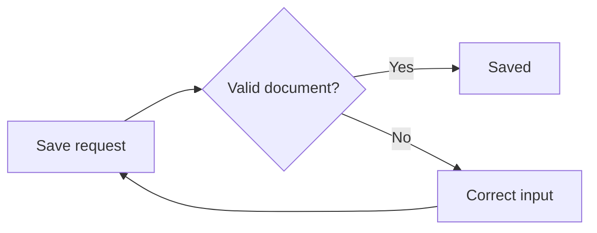
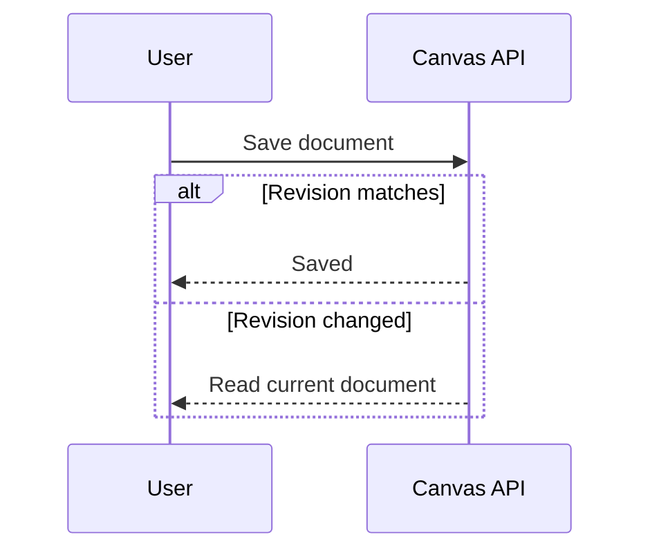
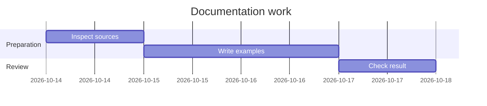
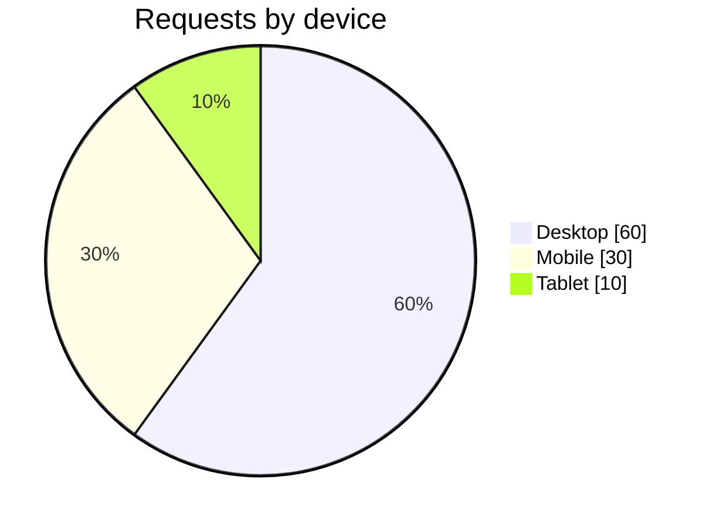
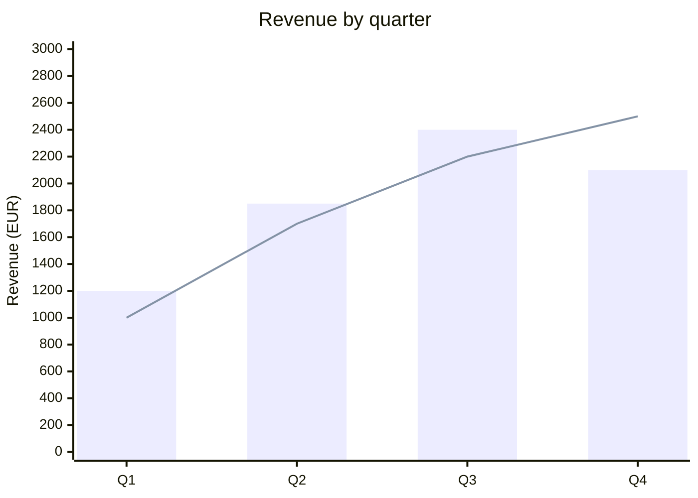

# Mermaid syntax: tested examples

The examples below are original fixtures parsed with Mermaid **11.16.1**. Their successful parsing is not a visual layout or PDF acceptance test. Pick the relevant example; keep declarations from different diagram types in separate blocks.

## Markdown wrapper

Use an opening fence of three backticks followed by `mermaid`, then the definition, then a closing fence. Use a longer outer fence if showing an example that itself contains fences. Keep Markdown headings, prose, and document YAML frontmatter outside the diagram block. Comment lines inside Mermaid start with `%%`.

## Processes and architecture: flowchart

`LR` means left to right; `TD` means top down. IDs and display labels are separate. A diamond expresses a decision and edge labels explain its branches.

Use `subgraph group_id["Group label"]` and its own closing `end` for grouping. Avoid lowercase `end` as a flowchart node ID. Node labels containing punctuation or non-ASCII characters should be quoted, for example `review["Prüfung (Schritt 2)"]`. For quotes inside a flowchart label, an entity such as `#quot;` avoids breaking the surrounding quotes. Plain labels are the safest portable default; do not insert HTML or assume Markdown formatting works identically in every diagram type.

## Exchanges over time: sequence

Declare participants with simple identifiers and descriptive aliases. `->>` is a message and `-->>` a dashed response. Close `alt`, `opt`, `loop`, and `par` blocks with `end`; keep activation/deactivation balanced if using them.

## Data relationships: ER

`||` denotes exactly one; `o{` denotes zero or more on that end. Name both entities and label the relationship. Entity attributes are optional and use `type name`, with optional `PK` or `FK` markers.

```mermaid
erDiagram
    WORKSPACE ||--o{ DOCUMENT : contains
    WORKSPACE {
        string id PK
        string title
    }
    DOCUMENT {
        string id PK
        string workspace_id FK
        string title
    }
```

## Schedule: Gantt

Set a matching `dateFormat`. Use unique task IDs when referring to another task with `after`. Dates here are illustrative; replace them with the user's actual schedule.

## Parts of a whole: pie

Use quoted labels and numeric values separated by a colon. A pie is appropriate for nonnegative parts of a meaningful whole; do not use it for unrelated metrics or values on incompatible scales.

## Simple numeric data: XY chart

Use `xychart-beta` for this tested version. A categorical x-axis lists categories in order; each series lists the corresponding numeric values in the same order. Use one value per category for this simple pattern. Choose a y-axis range that includes all values and label its unit.

This example compares actual revenue (bars) with target revenue (line); explain that mapping in surrounding prose. Named-series legend syntax from newer documentation is not part of these 11.16.1 examples. Do not imply that Canvas zoom/pan provides filtering or linked data selections. More advanced statistical plots or interactive analysis may need a different capability that is actually available.

## Official references

- [Flowcharts](https://mermaid.js.org/syntax/flowchart.html)
- [Sequence diagrams](https://mermaid.js.org/syntax/sequenceDiagram.html)
- [Entity relationships](https://mermaid.js.org/syntax/entityRelationshipDiagram.html)
- [Gantt](https://mermaid.js.org/syntax/gantt.html)
- [Pie](https://mermaid.js.org/syntax/pie.html)
- [XY Chart](https://mermaid.js.org/syntax/xyChart.html)
- [Accessible titles and descriptions](https://mermaid.js.org/config/accessibility.html)

These are live upstream pages and can document features newer than Canvas's installed Mermaid. Prefer the tested examples unless the newer feature has been checked against the current backend.
